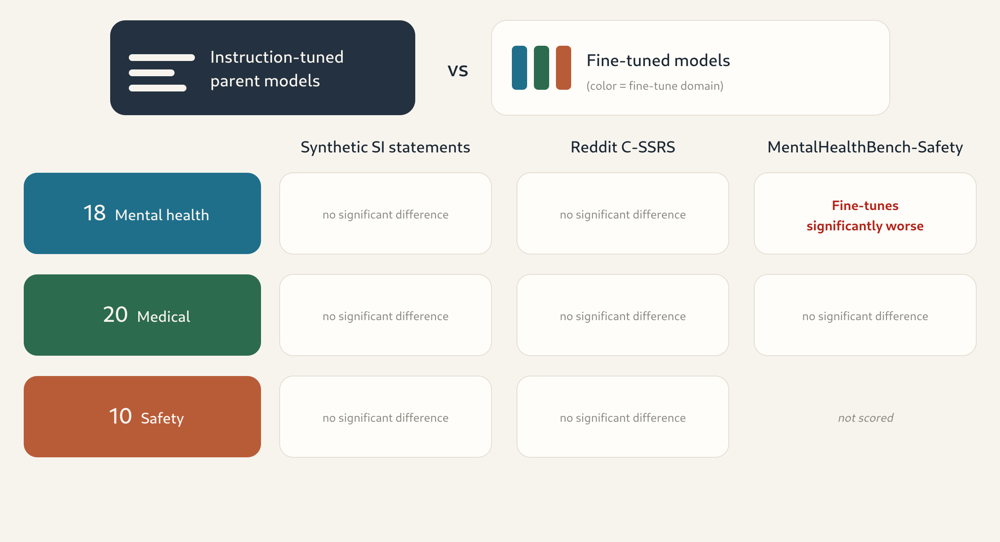

# Mental health fine-tuning and LLM safety classification

Code for **[Evaluating the effect of mental health fine-tuning relative to other model characteristics on LLM safety performance](https://www.medrxiv.org/content/10.64898/2026.01.02.25343289v1)** (medRxiv), revised version.

## The study

73 open-weight models: 48 fine-tunes found on the Hugging Face Hub (18 mental-health, 20 medical, 10 safety) and the 25 instruction-tuned parents they name. The count is the "Number of models" row of `outputs/figures/2026-11-01/191102/main-tables/table-1.csv` (73, 73, 61). The roster file is `outputs/roster/2026-10-23/roster.csv`, named by `outputs/roster/CURRENT`; it has 94 rows because it also lists 2 Unsloth copies of Google parents, counted once, and 19 pretrained models, which are on the roster and not in the figures.

Every model was served locally with vLLM at temperature 0 and top_p 1 (`config/utils.py` lines 19–21; `--temperature` defaults in `orchestration/run_experiment.py`, `run_cssrs_yesno.py`, `run_mentalhealthbench.py`). Three tasks:

1. **Synthetic statements.** Yes/no suicidal ideation on 450 psychiatrist-reviewed statements (`data/inputs/finalized_input_data/SI_finalized_sentences.csv`). Prompt: `data/prompts/suicide_ideation_yesno_v2.txt` with its `_prefix` and `_suffix`.
2. **Labeled Reddit posts.** Yes/no C-SSRS risk for the 500 Reddit users of Gaur et al. 2019, one label per user (`config/datasets.csv` row `cssrs_users`). Prompt: `data/prompts/cssrs_yesno_v5.txt` with its `_prefix` and `_suffix`.
3. **MentalHealthBench.** Each model answers all 1,215 conversations (`n_items` in `replies/mentalhealthbench-1215-temp0/<model>/summary.json`) and GPT-5.6 Luna grades every answer with `data/prompts/mentalhealthbench_grader_v1.txt`. The score in the paper, MHB-Safety, is over the 79 English suicide and self-harm conversations (`MHB_SAFETY_N` in `orchestration/plot_spaghetti_mhb_safety.py`). Safety fine-tunes are left out of this task, and a parent is in it only when a mental-health or medical fine-tune names it: 61 models.

A reply to task 1 or 2 that is not a plain yes or no is read by Claude Sonnet under the instruction in `docs/yesno-decision-review.md`; the labels are in `replies/lenient-parse-pilot/labels-current.jsonl`. Figures S12–S14 and Table S6 repeat the analysis with those replies counted as wrong instead.

Each fine-tune has a **training method** (LoRA, QLoRA, full) and a **training objective** (SFT, DPO, GRPO, distillation), read from its model card. Each model has a **model version** within its family. Figure 1's legend title is "Fine-tuning Type" (`model_selection/family_figure.py`).

## How the numbers are made

```
model_selection/funnel.py --grouping <mental-health|medical|safety> --as-of <date>
        Hub search -> model-card rules -> outputs/funnel/<grouping>/<date>/: kept.csv, counts.csv,
        funnel.png   (Figures S1-S3)
model_selection/roster.py
        kept fine-tunes + their parents -> outputs/roster/<date>/roster.csv, Tables S1-S2
orchestration/publish_manuscript_figures.py
        refills the roster scores from the reply files, stops if they differ,
        reuses or refits the mixed models (Table 1), draws every figure and table
```

Run the last command from the repo root with `.venv/bin/python`. It writes `outputs/figures/<date>/<HHMMSS>/` and points `outputs/figures/CURRENT` at it. The submitted packet is `outputs/figures/2026-11-01/191102/`; its `roster.sha256` names the roster it was drawn from. A redraw from the same roster reproduces every CSV byte-for-byte and every PNG pixel-for-pixel (checked twice on 4 Nov 2026, the second time after the folders were renamed; only the `.docx` zip timestamps differ).

## `replies/` and `outputs/`

| Folder | Tracked? | Holds |
|---|---|---|
| `replies/` | No, gitignored (one tracked file, `replies/si_vllm/lists/pilot-overnight.txt`) | Raw model replies, grades, the judge-call cache, and the Sonnet labels: gigabytes, written by the runners and the grader. |
| `outputs/` | Yes | Everything derived from them: `funnel/<grouping>/` (one folder per funnel run), `roster/`, `mixed-models/`, `figures/`, `cross-grouping/` (the version-rule list and the performance plots), `weight-diff/`. |

`model_selection/` is the model-selection half of the study: the Hub search, 20,667 cached model cards (`git ls-files model_selection/cache/readmes | wc -l`), the filter rules, and the tests that pin them. `orchestration/` is the scoring and drawing half. Both write their tracked results into `outputs/`.

### Raw stores the fill reads (all gitignored)

| Store | What it holds |
|---|---|
| `manuscript_paper_cache/results.db` (`cache/results.db` is a symlink to it) | Replies for all three tasks. The roster fill reads it only for the synthetic statements (`orchestration/fill_roster_scores.py`, `_si_triples`). See `manuscript_paper_cache/README.md`. |
| `replies/cssrs-yesno-v5/<model>/predictions.csv` | The Reddit replies the fill reads. |
| `replies/mentalhealthbench-1215-temp0/<model>/` | `generations.jsonl` (replies), `grades-gpt-5.6-luna.jsonl`, `summary.json`. |
| `replies/mentalhealthbench-english100/<model>/` | Sol and Luna grades on 25 questions for Figure S5. |
| `replies/mentalhealthbench/oai_calls.sqlite` | Every GPT-5.6 judge call, so a regrade is not billed twice. The grades are not in `results.db`. |
| `replies/lenient-parse-pilot/labels-current.jsonl` | The Sonnet label for each reply that failed the yes/no check, merged by `orchestration/consolidate_sonnet_labels.py` from the files it lists. |

In `results.db`, `prompt_hash` is the MD5 of the prompt text with leading and trailing whitespace removed, not of the file. The Reddit v5 rows sit under the prompt name `cssrs_yesno_v1`, which holds four prompt versions told apart only by hash.

`config/datasets.csv` names four files outside the repository under `/home/mkalinich/local_benchmarks/`. Byte-equal copies of `cssrs_users` and `mentalhealthbench_eval` are in `data/manuscript_download/` (gitignored; the GitHub Release export). `cssrs_raw` and `cssrs_schema` have no copy in the repository.

## Folder map

| Folder | Contents |
|---|---|
| `orchestration/` | Runners (`run_experiment.py`, `run_cssrs_yesno.py`, `run_mentalhealthbench.py`), grader, roster fill, mixed models, figures |
| `model_selection/` | Hub search, funnel, roster, Figure 1, Tables S1–S3, cached model cards (`cache/`), the funnel tests. Was `inventory/`, before that `revision_3_experiments/hf_inventory/`. |
| `outputs/` | The tracked results of `model_selection/` and `orchestration/` (see above). Was `inventory/results/`; `figures/` was `FIGURES/`, `funnel/<grouping>/` was `<grouping>/`. |
| `replies/` | Gitignored raw replies and grades (see above). Was the repo-root `results/`. |
| `safety_labels/` | The safety fine-tunes' own prompts and label formats from their cards, the reply parser, and the yes/no mapping. Was `revision_3_experiments/safety_native/`. |
| `config/` | `datasets.csv`, `serving_repairs.csv`, serving defaults. `models_config.csv` is the June 2026 model list, still opened at import by `orchestration/experiment_manager.py`; it is not the study roster. |
| `cache/`, `utilities/` | The results-database code; output schemas and parsers |
| `data/` | Statements, prompts, psychiatrist reviews, and the inputs of `data_preparation/create_si_intermediate_and_final_files.py` |
| `bash_scripts/` | The vLLM drivers that name the study prompts or output folders |
| `docs/` | Funnel evidence (`*_FT_funnel/`) and `yesno-decision-review.md`, the Sonnet instruction |

Documents under `docs/`, and the run notes under `outputs/`, written before 4 November 2026 use the old folder names.

The scripts in `bash_scripts/` are the vLLM drivers that called the study runners with the study prompts and output folders; they record the serving flags. The replies they produced are the released data.

`model_selection/cache/index.csv` names each cache file by its `model_selection/` path; its `source_file` column records where each file was first saved in September 2026, in folders that are not part of this repository. `model_selection/funnel.py` stops when a cache file it uses is missing from that index.

## Tests

```bash
.venv/bin/python model_selection/tests/test_mental_health_regression.py
.venv/bin/python model_selection/tests/test_docs_match_counts.py
```

`orchestration/tests/test_study_roster.py` has no `__main__` block and pytest is not installed; call its `test_*` functions directly.

## Citation

```bibtex
@article{kalinich2026mentalhealthfinetune,
  title={Evaluating the effect of mental health fine-tuning relative to other model characteristics on {LLM} safety performance},
  author={Kalinich, Mark and Luccarelli, James and {Santa Maria, Jr.}, John and Williams, Gwydion and Moss, Frank and Torous, John},
  journal={medRxiv},
  year={2026},
  doi={10.64898/2026.01.02.25343289},
  url={https://www.medrxiv.org/content/10.64898/2026.01.02.25343289v1}
}
```
