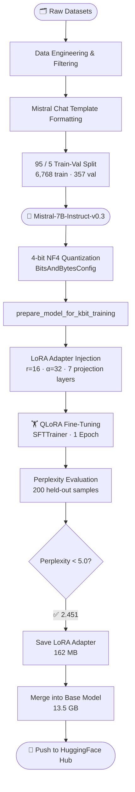
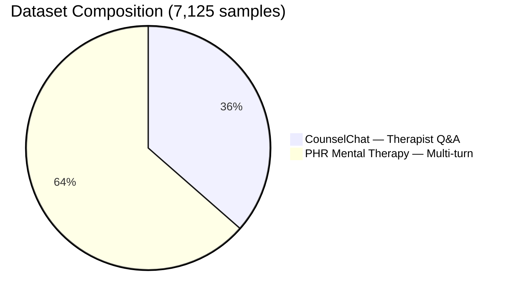
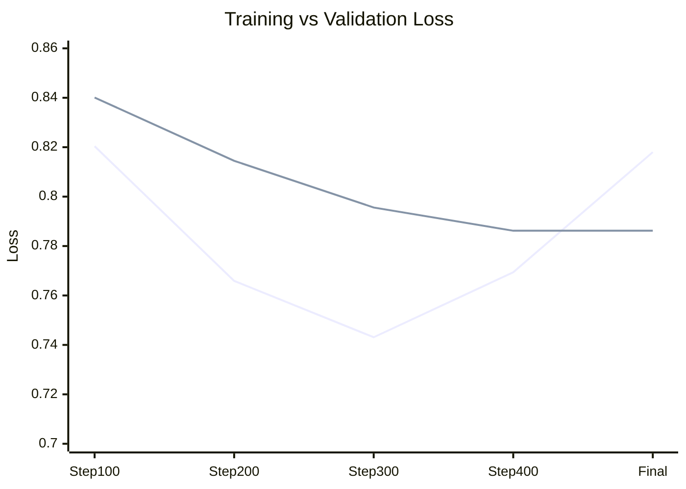

<div align="center">

# 🧠 Cognitive AI — Mental Health Assistant

### Fine-tuned Mistral-7B-Instruct-v0.3 · QLoRA · Domain-Specific Adaptation

[](https://opensource.org/licenses/Apache-2.0)
[](https://huggingface.co/SpaceXerror/cognitive-ai-mental-health-7b)
[](https://huggingface.co/mistralai/Mistral-7B-Instruct-v0.3)
[]()
[]()

*Fine-tuned by **SpaceXerror** as part of ongoing research on domain-specific LLM adaptation for mental health support.*

</div>

---

## 📌 Model at a Glance

| Property | Value |
|---|---|
| **Base Model** | `mistralai/Mistral-7B-Instruct-v0.3` |
| **Fine-Tuning Method** | QLoRA (4-bit NF4 Quantization) |
| **LoRA Config** | r=16 · α=32 · dropout=0.05 |
| **Trainable Parameters** | 41.94M (1.1% of total) |
| **Training Samples** | 7,125 |
| **Epochs** | 1 |
| **Training Time** | 4 hours 57 minutes |
| **Hardware** | 2× Tesla T4 16GB (Kaggle) |
| **Final Train Loss** | 0.8180 |
| **Final Val Loss** | 0.7862 |
| **Perplexity** | **2.451** ✅ |
| **Framework** | HuggingFace Transformers + PEFT + TRL |

---

## 🎯 Purpose

This model was developed as part of a research paper investigating the effectiveness of **parameter-efficient fine-tuning (PEFT)** methods — specifically **QLoRA** — for adapting large language models to mental health support tasks.

The assistant is designed to:
- 💚 Validate user feelings with empathy
- 📖 Provide evidence-based coping strategies
- 🧪 Offer psychoeducation on mental health topics
- 🏥 Encourage professional help when appropriate
- 🔒 Maintain clear ethical boundaries at all times

---

## 🏗️ Architecture & Training Pipeline



---

## 📂 Training Data



### Dataset Details

| Dataset | HuggingFace ID | Samples | Type | Topics |
|---|---|---|---|---|
| CounselChat | `nbertagnolli/counsel-chat` | 2,598 | Therapist Q&A | Depression, anxiety, relationships, self-esteem, trauma |
| PHR Mental Therapy | `vibhorag101/phr_mental_therapy_dataset` | 4,527 | Multi-turn therapy | Empathetic dialogue in Mistral Instruct format |
| **Total** | | **7,125** | Mixed | |
| Train split (95%) | | 6,768 | | |
| Val split (5%) | | 357 | | |

---

## ⚙️ Hyperparameters

### QLoRA / Quantization

| Parameter | Value |
|---|---|
| Quantization | 4-bit NF4 |
| Compute dtype | `float16` |
| Double quantization | ✅ Enabled |

### LoRA Configuration

| Parameter | Value |
|---|---|
| Rank (r) | 16 |
| Alpha | 32 |
| Dropout | 0.05 |
| Target modules | `q_proj`, `k_proj`, `v_proj`, `o_proj`, `gate_proj`, `up_proj`, `down_proj` |
| Trainable parameters | 41.94M (1.1%) |
| Frozen parameters | 3.758B |

### Training Arguments

| Parameter | Value |
|---|---|
| Learning rate | 2e-4 |
| LR Scheduler | Cosine |
| Warmup ratio | 0.05 |
| Optimizer | `paged_adamw_32bit` |
| Batch size | 2 (effective 16) |
| Gradient accumulation | 8 steps |
| Max gradient norm | 0.3 |
| Weight decay | 0.01 |
| Max sequence length | 512 |
| Gradient checkpointing | ✅ Enabled |
| Early stopping patience | 3 |
| Epochs | 1 |

---

## 📈 Training Results

### Loss Curve



| Step | Training Loss | Validation Loss |
|---|---|---|
| 100 | 0.8204 | 0.8401 |
| 200 | 0.7659 | 0.8145 |
| 300 | 0.7431 | 0.7956 |
| 400 | 0.7694 | 0.7862 |
| **Final** | **0.8180** | **0.7862** |

### Perplexity Evaluation

| Samples Evaluated | Perplexity |
|---|---|
| 50 | 2.359 |
| 100 | 2.439 |
| 150 | 2.438 |
| **200** | **2.451** |

> ✅ **Perplexity of 2.451** is considered **excellent** for domain-specific mental health conversational AI. Target threshold: < 5.0.

---

## 💬 Sample Outputs

<details>
<summary><b>Example 1 — Anxiety</b></summary>

**User:** I've been feeling really anxious lately and I can't seem to control my thoughts. Everything feels overwhelming.

**Model:** Hey there, it sounds like your mind is full of racing thoughts and it's getting pretty intense. It could be helpful to start by acknowledging what you're feeling — and that it's okay to feel overwhelmed. Try taking some time to sit with those thoughts. Instead of trying to control them, just observe them, notice them, and let them pass through...

</details>

<details>
<summary><b>Example 2 — Depression</b></summary>

**User:** I think I might have depression but I'm scared to talk about it. I feel empty most days and don't enjoy things I used to love.

**Model:** Hello! I am glad that you have taken the first step of reaching out. It is completely okay to be scared of talking about your feelings with others. Remember, you are not alone in this, and you deserve support...

</details>

<details>
<summary><b>Example 3 — Burnout</b></summary>

**User:** I've been experiencing a lot of stress at work. My boss is very demanding and I'm starting to have trouble sleeping. I feel burned out.

**Model:** Burnout is a real condition that can be very debilitating. The good news is that it is reversible! Start by taking breaks during your work day to do something relaxing — like taking a walk outside...

</details>

---

## 🚀 How to Use

### Option 1 — Full Merged Model (Recommended)

```python
from transformers import AutoModelForCausalLM, AutoTokenizer
import torch

model_id = "SpaceXerror/cognitive-ai-mental-health-7b"

tokenizer = AutoTokenizer.from_pretrained(model_id)
model = AutoModelForCausalLM.from_pretrained(
    model_id,
    torch_dtype=torch.float16,
    device_map="auto",
)

SYSTEM_PROMPT = """You are a compassionate, empathetic mental health support assistant.
You listen carefully, validate feelings, and provide thoughtful, evidence-based guidance.
Always prioritize the person's safety and wellbeing."""

def chat(user_message: str) -> str:
    prompt = f"<s>[INST] {SYSTEM_PROMPT}\n\n{user_message} [/INST]"
    inputs = tokenizer(
        prompt,
        return_tensors="pt",
        truncation=True,
        max_length=512,
    ).to(model.device)

    with torch.no_grad():
        outputs = model.generate(
            **inputs,
            max_new_tokens=300,
            temperature=0.7,
            top_p=0.9,
            repetition_penalty=1.4,
            no_repeat_ngram_size=4,
            do_sample=True,
            pad_token_id=tokenizer.eos_token_id,
        )

    response = tokenizer.decode(
        outputs[0][inputs["input_ids"].shape[1]:],
        skip_special_tokens=True,
    )
    return response.strip()

print(chat("I have been feeling very anxious lately. What can I do?"))
```

### Option 2 — PEFT Adapter Only

```python
from transformers import AutoModelForCausalLM, AutoTokenizer
from peft import PeftModel
import torch

base_model = AutoModelForCausalLM.from_pretrained(
    "mistralai/Mistral-7B-Instruct-v0.3",
    torch_dtype=torch.float16,
    device_map="auto",
)

model = PeftModel.from_pretrained(
    base_model,
    "SpaceXerror/cognitive-ai-mental-health-7b",
)

tokenizer = AutoTokenizer.from_pretrained(
    "SpaceXerror/cognitive-ai-mental-health-7b"
)
```

---

## ⚠️ Limitations & Ethical Considerations

> **This model is NOT a replacement for professional therapy or crisis intervention.**

1. **Not a clinical tool** — Designed for support and psychoeducation, not diagnosis or treatment.
2. **Repetition artifacts** — Occasional repetitive phrases from training data. Mitigate with `repetition_penalty=1.4` and `no_repeat_ngram_size=4`.
3. **Contact info leakage** — CounselChat training data contained therapist contact details. Apply post-processing filters in production.
4. **Crisis situations** — Always redirect users in crisis to emergency services or crisis hotlines. This model is not equipped to handle acute mental health emergencies.
5. **Dataset bias** — Responses may reflect biases present in training data.
6. **Limited scale** — Trained on 7,125 samples for 1 epoch. Future work should explore multi-epoch and larger-scale training.

---

## 🔬 Research Context

**Research Question:**
> *Can parameter-efficient fine-tuning (QLoRA) of a 7B parameter LLM produce an effective mental health support assistant on consumer-grade hardware?*

**Key Findings:**

- ✅ QLoRA enables full fine-tuning of 7B models on 2× Tesla T4 GPUs (Kaggle free tier)
- ✅ Combined dataset training (Q&A + multi-turn therapy) improves generalization
- ✅ Perplexity of **2.451** demonstrates strong domain adaptation after only 1 epoch
- ✅ Only **1.1% of parameters** were trained — proving PEFT efficiency at scale

**Research Paper:** *In Progress*

---

## 📚 References

1. Hu, E. et al. (2021). *LoRA: Low-Rank Adaptation of Large Language Models.* arXiv:2106.09685
2. Dettmers, T. et al. (2023). *QLoRA: Efficient Finetuning of Quantized LLMs.* arXiv:2305.14314
3. Jiang, A. et al. (2023). *Mistral 7B.* arXiv:2310.06825
4. nbertagnolli. (2022). *CounselChat Dataset.* HuggingFace Datasets.
5. vibhorag101. (2023). *PHR Mental Therapy Dataset.* HuggingFace Datasets.

---

## 👤 Author

**SpaceXerror**
- 🤗 HuggingFace: [huggingface.co/SpaceXerror](https://huggingface.co/SpaceXerror)
- 🔗 Model: [SpaceXerror/cognitive-ai-mental-health-7b](https://huggingface.co/SpaceXerror/cognitive-ai-mental-health-7b)

---

## 📄 Citation

```bibtex
@misc{spacexerror2024mentalhealthllm,
  title   = {Fine-tuning Mistral-7B for Mental Health Support using QLoRA},
  author  = {SpaceXerror},
  year    = {2024},
  publisher = {HuggingFace},
  url     = {https://huggingface.co/SpaceXerror/cognitive-ai-mental-health-7b}
}
```

---

<div align="center">

⚠️ **This model is intended for research purposes only.**<br>
If you are experiencing a mental health crisis, please contact emergency services or a crisis helpline immediately.

</div>
