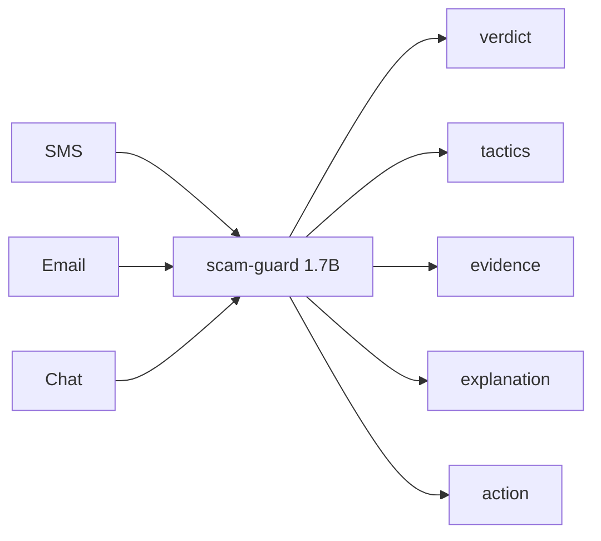

## Inference contract

Running this model correctly requires its **frozen inference contract** — the exact
system prompt, output JSON schema, user-turn format, and constrained-decode spec it
was trained against. See [`inference_contract/`](./inference_contract):

- [`INFERENCE.md`](./inference_contract/INFERENCE.md) — wiring guide: system prompt, user turn `[channel: <tag>]\n<message>` (tag `sms`/`email`/`chat`), **constrained JSON decoding** (required — pins the enums), and the verbatim-evidence check.
- [`prompt_scamguard_sys_v1.txt`](./inference_contract/prompt_scamguard_sys_v1.txt) — the system prompt, verbatim.
- [`schema_scamguard_v1.json`](./inference_contract/schema_scamguard_v1.json) — output JSON Schema for constrained decoding.

Prompt version `scamguard_sys_v1`. Do not edit the prompt/schema; the weights are trained against them.

# scam-guard 1.7B (working name) — the quality pick

**An on-device scam & fraud message detector for SMS, email, and chat text (English + Romanian).**

**How to read the numbers on this card.** The fine-tuned figures measured on the
synthetic benchmark are provisional: the benchmark is synthetic, not production traffic.
The out-of-distribution fresh-message results are separately measured and are included
below. Every fine-tuned figure here comes from the final CUDA 3-epoch run, which
supersedes an earlier MLX pass.

This is the **1.7B** model — the **more robust choice out-of-distribution** and the
**quality ceiling** of the two scam-guard sizes (~1.1 GB at int4). For the smallest,
fastest footprint on a phone, see the sibling **[0.6B on-device
pick](https://huggingface.co/flowxai/scam-guard-qwen06b)**.

Given one message, scam-guard returns a **3-level verdict**, the **manipulation
tactics** it found (each with a verbatim evidence span quoted from the message), a
**calm plain-language explanation**, and a **recommended safe action** from a fixed
list. It is built for everyday people — explicitly including **elderly and
non-technical users**, who are the most targeted.

The product insight that shapes everything: **the `suspicious` middle level exists
to be honest about uncertainty rather than force a binary.** A consumer safety tool
that must answer "scam or not" will either cry wolf or wave real scams through; a
third honest verdict — "this might be fine, verify through your own channel first"
— lets the model say *I'm not sure* instead of guessing. Relatedly, scam-guard
**never emits a probability**: an uncalibrated confidence number on a consumer
safety tool is worse than none, so we give you honest per-class behaviour instead
(see [Calibration](#calibration--we-dont-give-you-a-probability)).

- **`flowxai/scam-guard-qwen17b`** (this card, 1.7B) — the more robust choice out-of-distribution.
- **`flowxai/scam-guard-qwen06b`** (0.6B, sibling) — smallest and fastest; the on-device target (see [Size decision](#size-decision)).

Both are LoRA-fine-tuned from Apache-2.0 Qwen3 base models. On-device formats:
**GGUF** (llama.cpp, int8 `Q8_0` + int4 `Q4_K_M`) and **MLX-quantized** (int4 + int8;
mlx-swift runs these on iOS too).

---

## How do I use it?

Three copy-pasteable ways to turn a message into a verdict. All run **fully
on-device** — no network at inference, ever.

Real example input (a fresh Romanian courier-fee smishing message):

```
Coletul dumneavoastra nu a putut fi livrat. Pentru reprogramare achitati taxa
vamala de 3,20 lei aici: http://colet-reprogramare.example.net/plata Livrarea se
anuleaza in 48h.
```

### (a) llama.cpp / GGUF

Download a GGUF (int8 `Q8_0` recommended) and run the message through it. The model
emits a single strict JSON object.

**`llama-cli` (CPU-only, `-ngl 0`):**

```bash
llama-cli -m scam-guard-qwen17b-Q8_0.gguf -ngl 0 --temp 0 -no-cnv \
  -p "$(cat <<'EOF'
<system prompt: see src/scamguard/schema.py::SYSTEM_PROMPT>
[channel: sms]
Coletul dumneavoastra nu a putut fi livrat. Pentru reprogramare achitati taxa vamala de 3,20 lei aici: http://colet-reprogramare.example.net/plata Livrarea se anuleaza in 48h.
EOF
)"
```

**`llama-cpp-python`:**

```python
from llama_cpp import Llama
from scamguard.schema import SYSTEM_PROMPT, ScamGuardOutput  # the fixed task prompt + schema

llm = Llama(model_path="scam-guard-qwen17b-Q8_0.gguf", n_gpu_layers=0)
msg = ("Coletul dumneavoastra nu a putut fi livrat. Pentru reprogramare achitati "
       "taxa vamala de 3,20 lei aici: http://colet-reprogramare.example.net/plata "
       "Livrarea se anuleaza in 48h.")

out = llm.create_chat_completion(
    messages=[
        {"role": "system", "content": SYSTEM_PROMPT},
        {"role": "user", "content": f"[channel: sms]\n{msg}"},
    ],
    temperature=0.0,
)
raw = out["choices"][0]["message"]["content"]
verdict = ScamGuardOutput.model_validate_json(raw)   # strict, extra="forbid"
```

### (b) MLX (Apple Silicon)

Off the MLX-quantized weights (int4/int8):

```bash
mlx_lm.generate --model scam-guard-qwen17b-mlx-int4 --temp 0 \
  --prompt "$(printf '[channel: sms]\nColetul dumneavoastra nu a putut fi livrat. Pentru reprogramare achitati taxa vamala de 3,20 lei aici: http://colet-reprogramare.example.net/plata Livrarea se anuleaza in 48h.')"
```

```python
from mlx_lm import load, generate
from scamguard.schema import SYSTEM_PROMPT

model, tok = load("scam-guard-qwen17b-mlx-int4")
msg = ("Coletul dumneavoastra nu a putut fi livrat. Pentru reprogramare achitati "
       "taxa vamala de 3,20 lei aici: http://colet-reprogramare.example.net/plata "
       "Livrarea se anuleaza in 48h.")
prompt = tok.apply_chat_template(
    [{"role": "system", "content": SYSTEM_PROMPT},
     {"role": "user", "content": f"[channel: sms]\n{msg}"}],
    add_generation_prompt=True, enable_thinking=False,
)
raw = generate(model, tok, prompt=prompt, max_tokens=256, verbose=False)
```

Either backend returns the **same strict JSON** for this message:

```json
{
  "verdict": "scam_likely",
  "tactics": [
    {
      "tactic": "subscription_trap",
      "evidence": "achitati taxa vamala de 3,20 lei",
      "explanation": "It asks you to pay a small fee to release a parcel."
    },
    {
      "tactic": "urgency_pressure",
      "evidence": "se anuleaza in 48h",
      "explanation": "It invents a 48-hour deadline to rush you."
    }
  ],
  "explanation": "This looks like a scam because it uses a fake fee to prompt a payment and pressures you with an artificial deadline; do not act on it, and check with the real organisation through a channel you already trust.",
  "recommended_action": "verify_via_official_app_or_site"
}
```

### (c) The demo verdict card (`demo/check.py`)

The reference demo renders that JSON as a card a family member can read. It
hard-enforces the no-network privacy promise. Select the 1.7B with `--size 1.7b`:

```bash
echo "Coletul dumneavoastra nu a putut fi livrat. Pentru reprogramare achitati taxa vamala de 3,20 lei aici: http://colet-reprogramare.example.net/plata Livrarea se anuleaza in 48h." | python demo/check.py --size 1.7b
```

Rendered output (the actual card, from `reports/ood_fresh_demo.md`):

```
====================================================================
  scam-guard  —  message safety check
====================================================================
  [!]  VERDICT:  Likely a scam

  This message shows clear signs of a scam. You do not need to do
  anything it asks. Take your time — real organisations are fine
  with you checking first.
--------------------------------------------------------------------
  What we noticed:
    - Sending a fake renewal or invoice to make you call or click
        seen in: "achitati taxa vamala de 3,20 lei"
    - Rushing you with a deadline or threat
        seen in: "se anuleaza in 48h"
--------------------------------------------------------------------
  What to do:
    Check directly using the company's official app or website
    that you open yourself — not the link here.
--------------------------------------------------------------------
  In plain words:
  This looks like a scam because it uses a fake renewal invoice to
  prompt a call and it pressures you with an artificial deadline;
  do not act on it, and check with the real organisation through a
  channel you already trust.
====================================================================
  scam-guard is a helper, not a guarantee. When in doubt, verify
  through a channel you already trust. It never opens links.
====================================================================
```

`demo/check.py` defaults to the 0.6B; pass `--size 1.7b` for this model.
`--backend gguf` and `--model <path>` switch weights/backend;
`--channel {sms,email,chat}` sets the channel tag.

---

## How it works



Compact ASCII flow — three channels in, one local model, five fields out:

```
SMS
    \
Email ---> scam-guard 1.7B
Chat      /
              |
              + verdict
              + tactics
              + evidence
              + explanation
              + action
```

Under the hood, `scam-guard` is: `tokenizer → Qwen3-1.7B (LoRA fine-tuned) →
constrained JSON decode → evidence verifier (verbatim-substring kill-switch:
drops fabricated spans)`.

**The evidence kill-switch is the safety-critical stage.** Every tactic must cite a
span that is a **verbatim substring** of the input message (whitespace-normalized
only — no case/diacritic folding). A tactic whose evidence is not found verbatim is
**dropped and counted** as fabricated, so the model can never hallucinate a quote to
justify a warning.

---

## Output schema

A single strict JSON object (`extra="forbid"`, frozen — a spurious field like
`confidence` is rejected):

- `verdict` — `scam_likely` | `suspicious` | `no_indicators` (**never a probability**).
  - `scam_likely` — a clear scam mechanism is present and driven by tactics.
  - `suspicious` — the honest middle: signals present but plausibly legitimate, or
    only weak indicators (urgency alone, a link alone, an authority claim with no
    ask). "Verify through your own channel first."
  - `no_indicators` — no scam mechanism; legitimate messages can be urgent and contain links.
- `tactics[]` — each `{tactic, evidence, explanation}`, where `tactic` is one of 13
  fixed ids and `evidence` is a **verbatim substring** (see the kill-switch above).
- `explanation` — one or two calm, actionable sentences.
- `recommended_action` — one id from a fixed list of 10 safe actions; the model can
  never compose free-text advice that points back at the scammer's own channel.

The 13 tactics: `urgency_pressure`, `authority_impersonation`, `payment_redirect`,
`credential_phishing`, `courier_customs_fee`, `prize_lottery`, `investment_too_good`,
`romance_advance_fee`, `family_emergency_impersonation`, `tech_support`,
`link_obfuscation`, `refund_overpayment`, `subscription_trap`.

The 10 safe actions: `call_bank_official_number`, `do_not_click_link`,
`verify_via_official_app_or_site`, `call_family_member_known_number`,
`do_not_share_codes_or_credentials`, `do_not_send_money`, `ignore_and_delete`,
`report_to_authorities`, `check_sender_address`, `no_action_needed`.

---

## On-device privacy promise

**scam-guard makes no network calls at inference, ever.** It reasons over the
message text only, fully locally. URL handling is **lexical only** — it inspects the
visible URL string (lookalike domains, userinfo tricks, shorteners, punycode hints)
and **never fetches anything**. This is the whole point: it works on messages people
would never upload to a cloud service. The reference demo (`demo/check.py`)
hard-enforces this with a no-network guard. At ~1.1 GB (int4), the 1.7B is larger
than the 0.6B on-device pick but still runs fully locally on modern hardware.

---

## Evaluation (1.7B)

Two evaluations, in order of what they tell you:

1. **Out-of-distribution (OOD) fresh messages** — the honest real-world signal.
2. **ScamGuardBench v0.2 synthetic bench** — a large in-distribution slice the model has
   a home-field advantage on (read the caveat).
3. **Calibration** — class-level behaviour, since there is no probability to calibrate.

All fine-tuned numbers below are the **FINAL CUDA 3-epoch** run (`qwen17b_cuda`),
which supersedes the MLX first pass.

### Out-of-distribution results (fresh CERT-pattern messages)

20 **fresh** messages — 10 realistic scam patterns modeled on current CERT/DNSC-style
alerts (RO+EN) and 10 genuinely legit messages — **hand-authored from public
alert-pattern descriptions, NOT run through the synthetic generator** the model
trained on, sanitized, and asserted text-disjoint from training + every ScamGuardBench
version (`tests/test_ood_fresh.py`). This is the honest generalization test. Full
write-up: `reports/ood_fresh_demo.md`.

| Model | Correct / 20 | Dangerous MISSES (scam→no_indicators) | FALSE ALARMS (legit→scam_likely) | verdict macro-F1 |
| --- | --- | --- | --- | --- |
| `flowxai/scam-guard-qwen17b` (1.7B, quality) | **19/20 (95%)** | 1 | **0** | 0.967 |
| claude-haiku-4-5 (OOD reference) | **19/20 (95%)** | 0 | 0 | 0.649 |
| `flowxai/scam-guard-qwen06b` (0.6B, sibling) | **18/20 (90%)** | 1 | **0** | 0.614 |

**Bench → OOD gap (the home-field advantage, quantified):** the 1.7B *holds*
out-of-distribution — macro-F1 **0.975 → 0.967 (−0.008)**, essentially no drop from
its synthetic-bench headline. On fresh CERT-pattern messages the extra capacity + full
3-epoch budget pays off. Legit-FP stays **0.000**.

Honest reading:

- **The one dangerous MISS:** the RO WhatsApp family-emergency scam *"Mama, am
  pierdut telefonul … poti sa imi trimiti 850 lei"*, waved through as
  `no_indicators`. **This persists at 1.7B + 3 epochs** — throwing more size and
  compute at it did NOT fix it — which confirms it is a **training-data gap, not a
  size/compute gap** (too few family-emergency-without-explicit-money-keyword
  examples). The frontier reference (haiku) catches it. It is the honest limitation
  to fix (a data addition, planned before v1).
- **Zero false alarms** — no legit message was flagged `scam_likely`. The
  "disable-in-a-week" failure mode did not appear on fresh legit traffic.
- **The 1.7B generalizes cleanly** — 19/20, OOD macro-F1 0.967, no macro-F1 drop. On
  the in-distribution bench the two sizes both scored ~0.9+; on fresh messages the
  extra capacity shows, which is what makes this the robust choice.
- **Format robustness held:** JSON validity 1.000 and evidence pass 1.000 on fresh
  text (no repair/fallback needed).

**RO vs EN, OOD (plain per-language accuracy over the 20-item OOD set — 9 RO / 11 EN;
a per-language F1 is not computed in the reports):**

| Model | RO correct | EN correct |
| --- | --- | --- |
| `flowxai/scam-guard-qwen17b` | 8 / 9 | 11 / 11 |

RO is the first-class target language: the single RO miss is the family-emergency
scam. On the in-distribution bench the RO-dominant tactics score at ceiling
(`family_emergency_impersonation` F1 **1.000**, `courier_customs_fee` **1.000**,
`refund_overpayment` **1.000**), which is exactly why the OOD RO family-emergency
miss is the honest gap to close.

### ScamGuardBench v0.2 (synthetic, in-distribution) — with the home-field caveat

> **Honesty caveat — home-field advantage (read before citing these numbers).** The
> fine-tuned numbers **beat the frontier reference on this benchmark, and that does NOT
> mean the model is a better real-world scam detector.** ScamGuardBench v0.2 is built from the
> **same synthetic generator** the model trained on (held-out split,
> contamination-verified — no leakage of specific messages, but the **same
> distribution**: same output format, phrasing, tactic-to-message style). The
> fine-tune learned exactly that style. **The frontier reference is the honest upper
> reference for a cold-prompted generalist** — a better OOD proxy than the fine-tuned
> column — and the OOD results above are the real-world signal these bench numbers
> flatter.

Seeded **120-message** slice (18 `suspicious`, 39 legit-confusable). A false positive
is a `scam_likely` verdict on a legitimate message; `suspicious` is reported but
**not** counted as an FP. FP-rate on the legit-confusable subset is the **release gate**.

| Metric | **qwen17b (CUDA)** | claude-haiku-4-5 (frontier ref) | keyword (lower ref) |
| --- | --- | --- | --- |
| JSON validity (deployed decoder) | 1.000 | 1.000 | 1.000 |
| **raw** JSON validity (no repair) | 1.000 | n/a | n/a |
| verdict micro-F1 | 0.983 | 0.900 | 0.483 |
| verdict macro-F1 | **0.975** | 0.829 | 0.482 |
| tactic macro-F1 | 0.950 | 0.770 | 0.319 |
| evidence pass rate | 0.974 | 0.969 | 1.000 |
| **legit-confusable FP-rate** | **0.000** | 0.051 | 0.026 |

The reference `claude-haiku-4-5` **fails the FP gate** (legit-confusable FP 0.051,
2/39 — it over-flags genuine family money requests), while the fine-tune holds
**0.000**. That is the home-field-advantage signal, not a claim of superior
real-world judgment. `family_money_request` (a genuine "send me money" from family)
is the hardest legit class — every frontier model over-flags it — while this
fine-tune holds **0.000**.

> **Full-budget note (MLX → CUDA).** The shipped 1.7B is the CUDA 3-epoch run. It
> supersedes the earlier MLX ~1-epoch first pass (macro-F1 0.921 → **0.975**,
> micro 0.950 → **0.983**), while **holding legit-FP at 0.000**. The full budget
> bought +5.4 macro-F1 points in-distribution — the largest lift being `suspicious`
> recall (MLX 0.833 → CUDA **0.944**, 17/18).

### Calibration — we don't give you a probability

scam-guard **deliberately emits no confidence percentage**. An uncalibrated number
on a consumer safety tool is worse than none: it invites false precision on a
judgement that is genuinely uncertain. Instead of a probability to calibrate, we give
you **honest per-class behaviour** so you know where the model is weak and where it is
safe.

**Confusion matrix** (`qwen17b` CUDA, ScamGuardBench v0.2, 120-item slice; rows = gold,
cols = predicted):

| gold \ pred | scam_likely | suspicious | no_indicators | recall |
| --- | --- | --- | --- | --- |
| scam_likely | 62 | 1 | 0 | 0.984 (n=63) |
| suspicious | 0 | 17 | 1 | 0.944 (n=18) |
| no_indicators | 0 | 0 | 39 | 1.000 (n=39) |

**Per-class precision / recall / F1** (`reports/eval_frontier.md`) — micro-F1 0.983,
macro-F1 0.975:

| Verdict | Precision | Recall | F1 | Support |
| --- | --- | --- | --- | --- |
| scam_likely | 1.000 | 0.984 | 0.992 | 63 |
| suspicious | 0.944 | 0.944 | 0.944 | 18 |
| no_indicators | 0.975 | 1.000 | 0.987 | 39 |

**Where the model is weak, and where it is safe.** The weakest class is still
`suspicious` (recall 0.944, 17/18) — the honest middle is the hardest to catch — but
the 1.7B lifts it well above the 0.6B (0.722). **Crucially, every `suspicious` miss
bleeds into `no_indicators` (the safe direction), never into `scam_likely`, and no
legit item is ever flipped to `scam_likely`** — which is why the legit-confusable
FP-rate is **0.000**. The model under-warns on ambiguous messages rather than
over-warning on real ones; for a consumer guard that is the failure mode you want.

### Size decision

- **This model (`flowxai/scam-guard-qwen17b`, 1.7B) — the more robust choice.** The
  OOD results are the reason: on fresh messages the extra capacity generalizes
  materially better (19/20, macro-F1 0.967, essentially no drop), a gap the
  in-distribution bench (both ~0.9+) did not surface. Passes all three release gates
  (JSON >99%, evidence >95%, legit-FP <3%). Choose it where quality — especially the
  honest middle class — is worth the ~1.1 GB (int4) footprint.
- **The sibling `flowxai/scam-guard-qwen06b` (0.6B) — smallest and fastest.** A
  genuinely defensible on-device ship at ~0.4 GB (int4) that also passes all three
  gates, but drops hardest out-of-distribution (macro-F1 −0.31, 18/20). Where
  size/latency matters more than robustness, [ship the
  0.6B](https://huggingface.co/flowxai/scam-guard-qwen06b).
- **The gap is ~4.9 macro-F1 points**, concentrated in `suspicious` recall (0.944 vs
  0.722); both sizes solve the two common classes and both hold legit-FP at 0.000,
  and **both share the RO family-emergency recall gap** (the one dangerous OOD miss).
  That shared recall gap is the honest thing to fix before any release claim.

---

## Formats & on-device latency (1.7B)

**We targeted 150 ms. We measured ~1.7 s (best path). This target is currently not
met.** scam-guard emits a full multi-field JSON card (~138 tokens), not a single
label, so decode dominates latency. The 1.7B is slower on every path than the 0.6B.

The headline configs for the 1.7B on the representative 300-char SMS (median, M3 Max):

| Config | median | meets 150 ms? |
| --- | --- | --- |
| MLX int4, Apple-Silicon GPU (Metal) | ~1.7 s | no |
| GGUF int8 (`Q8_0`), CPU-only (`-ngl 0`) | ~5.6 s | no |

int4 GGUF (`Q4_K_M`) is a poor trade on these small models — on CPU it is *slower*
than int8 and degrades quality (a spot-check sample became invalid JSON) — so
**`Q8_0` is the recommended GGUF quant**, and MLX int4 is the fastest quality-holding
path.

<details>
<summary>Full per-quant numbers (1.7B)</summary>

GGUF (llama.cpp), CPU-only (`-ngl 0`), M3 Max — full JSON card, median over N=12
(`reports/benchmark_gguf.json`):

| quant | file size | median | JSON spot-check |
| --- | --- | --- | --- |
| int8 (Q8_0) | 1834 MB | 5648 ms | 4/4 valid |
| int4 (Q4_K_M) | 1107 MB | 9394 ms | 3/4 (degraded) |

MLX-quantized, Apple-Silicon GPU (Metal), M3 Max (`reports/benchmark_mlx_quant.json`):

| quant | weights size | median | JSON spot-check |
| --- | --- | --- | --- |
| int4 | 968 MB | 1677 ms | 4/4 valid |
| int8 | 1828 MB | 2176 ms | 4/4 valid |

bf16 MLX-Metal latency/memory and per-input-length detail are in
`reports/benchmark.md`. **Core ML** (.mlpackage) was attempted; the LLM→Core ML
conversion is finicky (stateful KV-cache handling) and the attempt is documented in
`PROGRESS.md` rather than shipped as a fabricated artifact. GGUF and MLX are the
recommended on-device paths today.

</details>

A human decision is needed at the release STOP: accept the ~1.7–5.6 s latency, ship
the ~1.7 s GPU/MLX path, or shrink the output contract to approach 150 ms.

---

## Intended use & limitations

**Intended use.** A **consumer triage aid** that explains *why* a message looks risky
and points you to *your own* trusted channel to verify. Runs on-device. Languages: EN
and RO at v1 (Romanian is a first-class citizen, not an afterthought); PL/HU planned
fast-follow through the same pipeline.

**Out of scope & limitations.**

- **Not a guarantee.** A verdict is a signal, not proof. Scammers adapt continuously;
  the benchmark is versioned because patterns rotate.
- **Verdicts can be wrong in both directions** — a real scam may score
  `no_indicators` (the OOD RO family-emergency miss is a documented example), and a
  legitimate message may score `suspicious`. The `suspicious` middle level exists to
  be honest about uncertainty rather than force a binary.
- **Known recall gap:** the RO family-emergency pattern (framing without an explicit
  money-transfer keyword) can slip past this model — it persists even at 1.7B + 3
  epochs, confirming it is a training-data gap, fixable with a data addition before
  any release claim.
- **The model never fetches URLs.** It cannot tell you where a link *actually*
  resolves, only what the visible string suggests. A lexically-clean URL can still be
  malicious.
- Not a replacement for a bank's fraud line, a national anti-fraud service, or human
  judgment. The recommended action always routes to *your own* channel.
- **Text only** at v1: no image/OCR, no audio, no attachment parsing, no
  email-header/routing analysis.

---

## Training data

- **Public seed layer (relabeled):** UCI SMS Spam Collection (CC BY 4.0), enron_ham
  (SetFit/enron_spam ham slice; no explicit license → reference/research-use),
  phishing_email (zefang-liu; LGPL-3.0). Relabeled into the verdict+tactic scheme with
  the evidence kill-switch; per-source human spot-check kept relabel disagreement
  under the 10% gate.
- **Synthetic layer:** generated from specs (tactic × channel × language × register),
  including a `suspicious` middle-ground tier and adversarial keyword-evasion
  paraphrases (the `hard` subset). Every bench-destined message passes a sanitizer
  audit (reserved domains, non-dialable phones).
- **Balance:** ≥45% legitimate messages, RO ≥35%, ~40% of RO diacritic-free,
  `suspicious` ~14.5% of the SFT train set.
- Split discipline: synthetic by spec-family, public by source-text hash; paraphrases
  follow their parent's split. **Train ∩ ScamGuardBench = ∅** (contamination-verified).

Both sizes trained from the **same data**; the size decision is evidence-based (above).

## Fine-tuning

**CUDA full-budget 3-epoch LoRA** (`training/train_cuda.py`, transformers + PEFT +
trl `SFTTrainer`), from `Qwen/Qwen3-1.7B`. LoRA rank 16 / alpha 32 / dropout 0.05,
all-linear modules, adamw, cosine 2e-5→2e-6 with 60-step warmup, effective batch 4,
seq 1280, bf16, gradient-checkpointing, seed 20260703; **3 real epochs** on an
on-demand NVIDIA L4 (~3h21m, 0 OOM), thinking disabled. This **supersedes** the MLX
first pass (~1 epoch, bounded by Metal stalls); the full budget bought +5.4 macro-F1
points in-distribution.

> **Base-model note.** The exact repo `Qwen3-1.7B-Instruct` does **not** exist on
> Hugging Face — Qwen3 merged instruct+thinking into the single base repo
> `Qwen/Qwen3-1.7B` (instruction-capable, Apache-2.0). We fine-tune it with thinking
> disabled.

---

## Dual-use statement

We release a **detector**, a **benchmark**, and **pattern-level** explanations. We do
**not** release the scam-variant generation prompts as a standalone tool. Public
benchmark scam texts carry no real dialable phone numbers and no working URLs
(reserved/example domains and clearly-fake numbers only). Output explanations describe
the manipulation *pattern*, never instructions for constructing one.

## Links

- **Sibling model (on-device pick, 0.6B):** [`flowxai/scam-guard-qwen06b`](https://huggingface.co/flowxai/scam-guard-qwen06b) — smallest, fastest footprint (~0.4 GB int4).
- **Benchmark / dataset:** [`flowxai/scamguardbench`](https://huggingface.co/datasets/flowxai/scamguardbench).

## License

Apache-2.0 (weights, code, and benchmark). Base model `Qwen/Qwen3-1.7B` is Apache-2.0.
</content>
</invoke>
